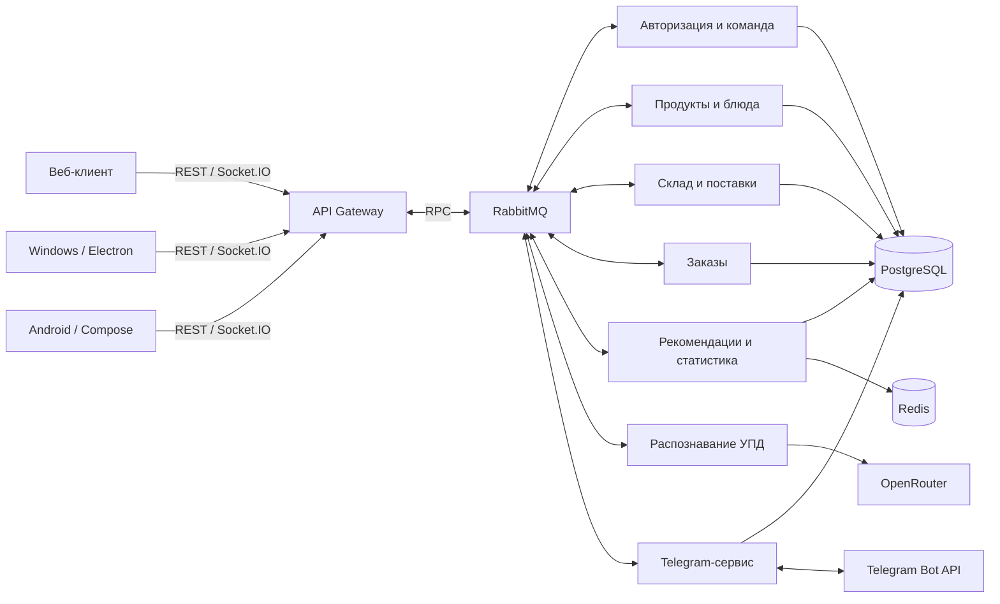

<p align="center">
  
</p>

<h1 align="center">STOQ</h1>

<p align="center">Склад, поставки, меню и заказы ресторана — в одной системе.</p>

<p align="center">
  <a href="https://lyaguh.site">Веб-приложение</a> ·
  <a href="https://lyaguh.site/swagger/">API</a> ·
  <a href="https://t.me/stoqhelperbot">Telegram-бот</a> ·
  <a href="https://github.com/MissClickRND/stoq-mobile/releases">Android-релизы</a>
</p>

STOQ связывает работу с продуктами и работу с блюдами. Поставка пополняет складские партии, состав блюда определяет расход ингредиентов, а остатки влияют на доступность меню. Администратор видит статистику и действия сотрудников, кладовщик работает с поставками и инвентаризацией, официант — с заказами.

Этот репозиторий объединяет три проекта через Git submodules. Каждый разрабатывается отдельно; здесь зафиксированы их конкретные версии, общая документация и скриншоты.

## Возможности

| Раздел | Что можно сделать |
| --- | --- |
| Склад | Посмотреть остатки по продуктам и партиям, сроки годности, историю списаний; провести инвентаризацию |
| Поставки | Создать или изменить поставку, указать цены, количество и сроки годности; отследить приёмку и отмену |
| Распознавание УПД | Загрузить изображение или PDF и получить данные для формы поставки; проверить их перед сохранением |
| Блюда | Настроить состав и цену, посмотреть себестоимость и продажи; определить доступность по ингредиентам |
| Заказы | Создать заказ, добавить блюда, указать стол и гостей; изменить статус и увидеть автора |
| Аналитика | Посмотреть выручку, расчётную прибыль, средний чек, динамику заказов, дефицит продуктов и состав стоп-листа |
| Команда | Подтвердить сотрудника, назначить роль, заблокировать доступ, создать или отозвать приглашение |
| Журнал | Посмотреть действия сотрудников и изменения склада: сначала новые события, затем история с подгрузкой |
| Telegram | Выбрать уведомления, получить сводку по запросу или включить ежедневную отправку |

Просроченные партии списываются автоматически и исчезают из основных остатков. Они остаются в отдельном списке до подтверждения утилизации; история складских движений сохраняется. Изменения склада и доступности блюд поступают клиентам через Socket.IO.

Расчётная прибыль — выручка за вычетом стоимости ингредиентов. Она не учитывает аренду, зарплаты и налоги; при отсутствии исходных цен система не подставляет вымышленные суммы.

## Приложения и репозитории

| Репозиторий | Назначение | Основные технологии |
| --- | --- | --- |
| [stoq-frontend](https://github.com/MissClickRND/stoq-frontend) | Веб-интерфейс, гостевой заказ и приложение для Windows | React, TypeScript, Vite, Mantine, Redux Toolkit / RTK Query, Electron |
| [stoq-backend](https://github.com/MissClickRND/stoq-backend) | API Gateway, бизнес-сервисы, распознавание документов и Telegram-бот | NestJS, TypeScript, PostgreSQL, Prisma, RabbitMQ, Redis |
| [stoq-mobile](https://github.com/MissClickRND/stoq-mobile) | Нативное Android-приложение | Kotlin, Jetpack Compose, Hilt, Retrofit, Coroutines / Flow, Room, DataStore |

```text
stoq/
├── stoq-frontend/    # Git submodule: веб и Windows
├── stoq-backend/     # Git submodule: сервер и фоновые сервисы
├── stoq-mobile/      # Git submodule: Android
├── screens/
│   ├── web/
│   └── mobile/
└── README.md
```

Отдельного репозитория для десктопа нет: Electron упаковывает веб-клиент. Android-приложение имеет собственный интерфейс и сетевой слой. В нём доступны локальные черновики заказов, поставок и инвентаризаций, светлая и тёмная темы, камера для съёмки УПД. Черновики разделены по аккаунтам; их наличие не означает, что серверные операции можно выполнять без сети.

## Как устроена система



Gateway принимает HTTP-запросы и обслуживает Socket.IO. Внутренние команды и события проходят через существующие RabbitMQ exchanges `app.commands` и `app.events`. PostgreSQL хранит данные сервисов, Redis используется в сервисе рекомендаций.

Данные ограничены рестораном пользователя, а доступ к операциям определяется его ролью: администратор, менеджер, официант или кладовщик. Статистику рассчитывает backend; клиенты отображают результат.

Telegram доступен администратору и менеджеру. Вход создаёт отдельную сессию, поэтому выход из бота не завершает веб-сессию. В настройках можно выбрать категории уведомлений и время ежедневной сводки. Сводка по запросу охватывает текущий московский день, ежедневная — предыдущий полный день.

В текущей конфигурации основные сервисы, PostgreSQL, RabbitMQ и Redis работают на сервере. AI и Telegram запускаются на отдельном Windows-компьютере и подключаются к серверу через SSH-туннель. Их работа зависит от доступности этого компьютера и внешних API.

## Получение исходников

Нужен Git с поддержкой сабмодулей:

```bash
git clone --recurse-submodules https://github.com/MissClickRND/stoq.git
cd stoq
```

Если репозиторий уже клонирован без сабмодулей:

```bash
git submodule update --init --recursive
```

Сабмодуль хранит ссылку на конкретный коммит, а не автоматически меняющуюся «последнюю версию». Параметр `branch = main` задаёт ветку для явного обновления:

```bash
git submodule update --remote --merge
git add stoq-frontend stoq-backend stoq-mobile
git commit -m "chore: update application submodules"
```

После получения изменений корневого репозитория достаточно выполнить `git submodule update --init --recursive`, чтобы перейти именно к зафиксированным версиям. Изменения приложения коммитятся и публикуются в его собственном репозитории; затем обновляется ссылка в `stoq`.

## Запуск

### Веб и Windows

Для frontend нужен Node.js 22.20+ и npm:

```bash
cd stoq-frontend
npm ci
```

Создайте `.env` по [примеру](stoq-frontend/.env.example). Для подключения к опубликованному backend:

```dotenv
API_PROXY_TARGET=https://lyaguh.site/api
VITE_API_URL=https://lyaguh.site/api
VITE_WEBSOCKET_API_URL=wss://lyaguh.site
```

В dev-режиме HTTP-запросы идут через `/api` и прокси Vite. `VITE_API_URL` используется в production-сборке. Для собственного backend замените адреса на его HTTP- и WebSocket-адреса.

```bash
npm run dev             # Веб-клиент
npm run desktop:dev     # Electron в режиме разработки
npm run build           # Веб-сборка в dist/
npm run desktop:build   # Установщик Windows x64 в release/
```

Windows-установщик собирается на Windows. На чистой машине Electron Builder может дополнительно загрузить инструменты упаковки.

### Backend

Зависимости устанавливаются отдельно в каталогах сервисов `stoq-backend/backend/`. Для полной системы нужны PostgreSQL, RabbitMQ, Redis и окружение каждого сервиса. Для распознавания нужен ключ OpenRouter, для бота — токен Telegram и ключ шифрования его сессий.

В корне backend находятся команды сборки и проверок; подробности подключения сервисов — в [документации backend](stoq-backend/README.md). Инструкция по совместному локальному запуску AI и Telegram — [LOCAL-SERVICES.md](stoq-backend/deploy/LOCAL-SERVICES.md).

Локальный supervisor использует заранее подготовленные SSH-ключ, настройки туннеля и env-файлы. Они не входят в репозиторий и не появляются после клонирования. Не подключайте новый экземпляр к рабочему окружению без этих настроек: конкурирующие процессы могут обрабатывать одни и те же команды или мешать Telegram long polling.

### Android

Откройте `stoq-mobile` в Android Studio. Проект использует JDK 17, Android SDK 36 и поддерживает Android 8.0+ (`minSdk 26`).

В `stoq-mobile/local.properties` укажите путь к Android SDK и адрес API с завершающим `/`:

```properties
sdk.dir=C:/Users/USERNAME/AppData/Local/Android/Sdk
BASE_API_URL=https://lyaguh.site/api/
```

Путь к SDK зависит от операционной системы. Затем можно запустить приложение из Android Studio или собрать debug APK:

```powershell
cd stoq-mobile
.\gradlew.bat assembleDebug
```

На macOS/Linux используйте `./gradlew assembleDebug`. APK появится в `app/build/outputs/apk/debug/`. Установка опубликованных версий описана в [мобильном репозитории](stoq-mobile/README.md#установка).

### Проверки

В корне frontend:

```bash
npm run typecheck
npm test
npm run build
```

В корне backend после установки зависимостей соответствующих сервисов:

```bash
npm run test:auth
npm run test:business
npm run test:ai
npm run test:telegram
```

Интеграционные проверки backend требуют отдельно настроенных тестовых БД и брокера. Для обычной работы клиентов прямой доступ к PostgreSQL не нужен — они обращаются к Gateway.

## Скриншоты

### Веб-приложение

**Аналитика и склад**

<p>
  <a href="screens/web/analytics.png"></a>
  <a href="screens/web/product-exsist.png"></a>
</p>

**Поставки и инвентаризация**

<p>
  <a href="screens/web/supply.png"></a>
  <a href="screens/web/inventory.png"></a>
</p>

**Блюда и заказы**

<p>
  <a href="screens/web/dishes.png"></a>
  <a href="screens/web/orders.png"></a>
</p>

**Зависимости ингредиентов и журнал**

<p>
  <a href="screens/web/graph1.png"></a>
  <a href="screens/web/logs.png"></a>
</p>

[Все скриншоты веб-приложения](screens/web)

### Android-приложение

**Дашборд, склад, поставки и распознавание УПД**

<p>
  <a href="screens/mobile/01-dashboard.png"></a>
  <a href="screens/mobile/02-inventory.png"></a>
  <a href="screens/mobile/06-supplies.png"></a>
  <a href="screens/mobile/25-supply-scan.png"></a>
</p>

**Заказы, блюда, стоп-лист и команда**

<p>
  <a href="screens/mobile/09-orders.png"></a>
  <a href="screens/mobile/12-dishes.png"></a>
  <a href="screens/mobile/13-stop-list.png"></a>
  <a href="screens/mobile/19-admin-employees.png"></a>
</p>

[Все скриншоты Android-приложения](screens/mobile)
